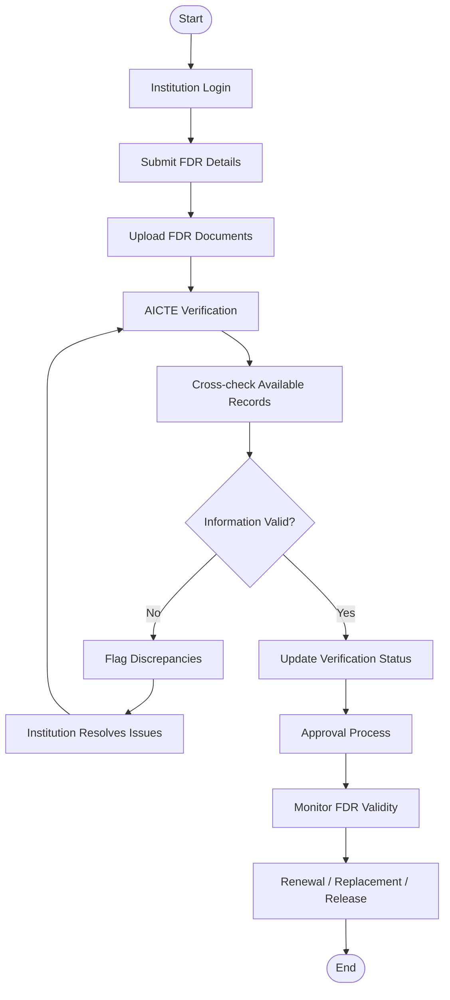
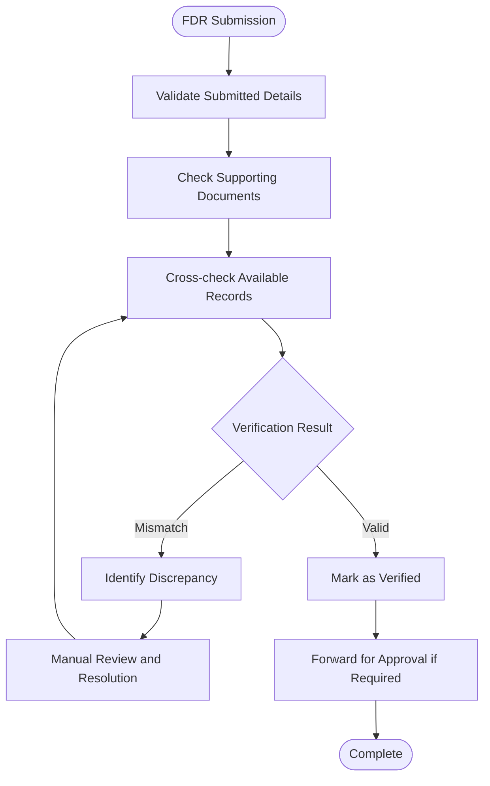
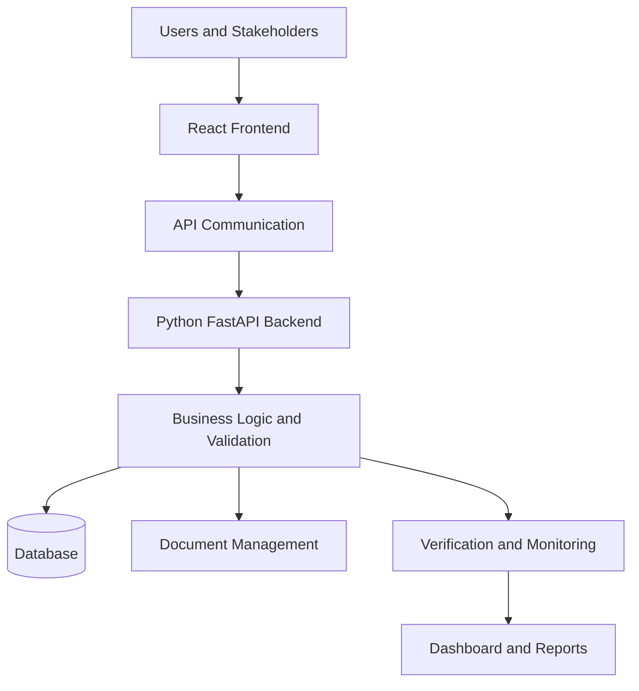

# 🏦 AICTE Security Deposit / FDR Management Portal


An integrated digital platform designed to simplify, manage, verify, monitor, and track Fixed Deposit Receipts (FDRs) and security deposits submitted by educational institutions to the All India Council for Technical Education (AICTE).

---

## 📌 1. Project Overview

The **AICTE Security Deposit / FDR Management Portal** is a centralized digital solution designed to streamline the complete lifecycle of institutional security deposits and Fixed Deposit Receipts (FDRs).

The portal provides a structured environment where educational institutions can submit FDR details, upload supporting documents, track verification status, request renewals or replacements, and initiate release or refund requests.

AICTE officials can verify submitted information, identify discrepancies, monitor FDR maturity dates, manage approval workflows, and generate reports through a centralized dashboard.

The system aims to improve transparency, reduce manual paperwork, minimize verification delays, and ensure efficient management of institutional financial records.

## 🎯 2. Problem Statement

Traditional security deposit and FDR management processes may involve:

- Manual submission and verification of FDR documents.
- Difficulty tracking FDR validity and maturity dates.
- Delays in communication between institutions and authorities.
- Risk of missing renewal deadlines.
- Difficulty identifying incorrect or inconsistent records.
- Lack of centralized monitoring and reporting.
- Time-consuming release and refund procedures.

These challenges create administrative overhead and make financial record management difficult.

## 💡 3. Proposed Solution

Our proposed portal provides a centralized platform for managing institutional FDR records digitally.

The system offers:

- Digital FDR submission and document management.
- Structured verification and record cross-checking.
- Discrepancy identification and resolution.
- FDR maturity and validity monitoring.
- Renewal and replacement request management.
- Release and refund request workflows.
- Role-based access control.
- Centralized dashboards and reports.
- Audit trail for important system activities.

## 🚀 4. Key Features

### 4.1 User Authentication
- Secure login and authentication.
- Role-based access for different stakeholders.
- Controlled access to authorized functionalities.

### 4.2 FDR Submission
- Submit FDR details through digital forms.
- Upload supporting FDR documents.
- Maintain institution-wise FDR records.

### 4.3 FDR Verification
- Verify submitted FDR information.
- Cross-check institution, bank, and AICTE records.
- Identify missing, incorrect, or inconsistent information.
- Flag discrepancies for further review.

### 4.4 FDR Status Tracking
- Track submitted FDR records.
- View verification and approval status.
- Monitor validity and maturity information.

### 4.5 Renewal and Replacement
- Submit renewal requests.
- Submit replacement FDR details.
- Track request processing status.

### 4.6 Release and Refund Management
- Submit release or refund requests.
- Forward requests for authorized approval.
- Track approval and rejection decisions.

### 4.7 Alerts and Notifications
- Notifications regarding FDR validity.
- Maturity and expiry reminders.
- Updates about verification and request status.

### 4.8 Dashboard and Reports
- Centralized administrative dashboard.
- Institution-wise FDR information.
- Verification and approval summaries.
- Reports for monitoring and decision-making.

### 4.9 Administration and Audit Trail
- User and role management.
- Authorized system configuration.
- Activity tracking and audit records.

---

## 👥 5. Stakeholders

| Stakeholder | Responsibilities |
|---|---|
| AICTE Official | Verify FDR records and monitor institutional deposits |
| Educational Institution | Submit FDR details and manage requests |
| Bank / Authorized Financial Source | Provide or confirm FDR verification information through authorized mechanisms |
| Approving Authority | Review and approve or reject requests |
| System Administrator | Manage users, roles, configurations, and audit records |

---

## ⚙️ 6. System Workflow

The portal follows a structured workflow for FDR submission, verification, approval, and monitoring.



## 🔍 7. FDR Verification Workflow



**Note:** Bank verification depends on the availability of authorized verification mechanisms. The system does not assume automatic integration with every bank.

---

## 🏗️ 8. System Architecture

The portal follows a client-server architecture.



### Main Components

1. **Frontend:** User interface for institutions, AICTE officials, and administrators.
2. **Backend:** Handles API requests, business logic, validation, and workflows.
3. **Database:** Stores institutional information, FDR records, user details, and request information.
4. **Document Management:** Handles supporting FDR document uploads.
5. **Verification Module:** Supports record checking and discrepancy identification.
6. **Monitoring Module:** Tracks FDR validity, maturity, and request status.

---

## 🛠️ 9. Technology Stack

| Component | Technology |
|---|---|
| Frontend | React.js |
| Frontend Build Tool | Vite |
| Backend | Python |
| API Framework | FastAPI |
| Database | SQLite / PostgreSQL |
| API Communication | REST API |
| Version Control | Git and GitHub |
| Deployment | Vercel / Compatible Hosting |

*Note: Confirm the actual database and deployment configuration against the project source code.*

## 🗂️ 10. Main Functional Modules

| Module | Description |
|---|---|
| Authentication | Login and role-based access |
| Institution Management | Institutional information management |
| FDR Management | FDR submission and tracking |
| Document Management | Upload and maintain supporting documents |
| Verification | Validate and cross-check FDR records |
| Discrepancy Management | Identify and resolve inconsistencies |
| Maturity Monitoring | Monitor validity and maturity dates |
| Renewal Management | Handle renewal and replacement |
| Release Management | Manage release and refund requests |
| Reporting | Generate dashboards and reports |
| Administration | Manage users, roles, and configurations |
| Audit Management | Maintain activity history |

---

## 📊 11. Expected Benefits

- Reduces manual paperwork and administrative effort.
- Improves transparency in FDR management.
- Enables centralized financial record monitoring.
- Helps prevent missed maturity and renewal deadlines.
- Simplifies communication between institutions and AICTE.
- Improves discrepancy identification and resolution.
- Provides structured approval workflows.
- Improves accessibility of institutional FDR information.

## 🔮 12. Future Enhancements

The following enhancements can be considered for future development:

1. Authorized real-time bank verification integration.
2. AI-assisted FDR document extraction using OCR.
3. Automated discrepancy detection.
4. Advanced fraud and duplicate-record detection.
5. Automated email and SMS notifications.
6. Secure digital document signing.
7. Advanced analytics and financial reporting.
8. Integration with authorized institutional and financial databases.
9. Enhanced audit logging and security monitoring.

---

## 💻 13. Installation and Setup

### Prerequisites

Install the following software:

- Python 3.10 or later.
- Node.js and npm.
- Git.
- Visual Studio Code (recommended).

### Step 1: Clone the Repository

```bash
git clone https://github.com/gauravdkolhe/AICTE-Security-Deposit-FDR-Portal.git
```

### Step 2: Navigate to the Project

```bash
cd AICTE-Security-Deposit-FDR-Portal
```

### Step 3: Install Frontend Dependencies

```bash
cd frontend
npm install
```

### Step 4: Start the Frontend

```bash
npm run dev
```

### Step 5: Start the Backend

Open another terminal and navigate to the backend directory containing the Python API.

Install the required dependencies using the project's requirements file:

```bash
pip install -r requirements.txt
```

Start the backend according to the project's FastAPI entry point. For example, if the application object is `app` inside `api/index.py`:

```bash
uvicorn api.index:app --reload
```

*Adjust the backend command and dependency file path if your actual project structure differs.*

---

## 🌐 14. Deployment

The project is maintained on GitHub and can be deployed using compatible hosting platforms.

**GitHub Repository:**

https://github.com/gauravdkolhe/AICTE-Security-Deposit-FDR-Portal

Deployment considerations:

- Configure frontend build settings.
- Configure backend API routing.
- Set required environment variables.
- Configure database connectivity.
- Verify API communication after deployment.
- Test authentication and core workflows.

---

## 🧪 15. Testing

The following areas should be tested:

- User login and authentication.
- Role-based access permissions.
- FDR submission and document uploads.
- Verification and discrepancy handling.
- FDR status tracking.
- Renewal and replacement requests.
- Release and refund workflows.
- Dashboard and report generation.
- Audit trail functionality.

## 📚 16. Project Summary (Simple Explanation)

In simple terms, this project is a digital platform that helps AICTE and educational institutions manage Fixed Deposit Receipts (FDRs) and security deposits in one place.

Instead of handling documents and financial records manually, institutions can submit their FDR details online, upload documents, and track their status.

AICTE officials can verify the submitted information, identify discrepancies, monitor maturity dates, and process requests.

The portal makes the complete FDR management process more organized, transparent, and efficient.

**In one sentence:**

A centralized digital platform for submitting, verifying, monitoring, renewing, and managing educational institutions' security deposits and FDRs.

---

## 👨‍💻 17. Project Information

| Field | Details |
|---|---|
| Project Name | AICTE Security Deposit / FDR Management Portal |
| Competition | Smart India Hackathon 2026 |
| Problem Statement ID | 26265 |
| Domain | Digital Governance / Financial Management |
| Project Type | Web-Based Application |
| Repository | GitHub |

## 📜 18. Disclaimer

This project is developed as a prototype.

The application demonstrates proposed workflows and functionalities for digital FDR management. Financial verification and approval actions require authorized institutional and banking mechanisms.

The prototype must not be treated as an official AICTE financial management system or used for real financial transactions without the necessary authorization, security controls, and institutional approvals.

---

**Developed for Smart India Hackathon 2026**

*Making Security Deposit and FDR Management Simpler, Smarter, and More Transparent.*
